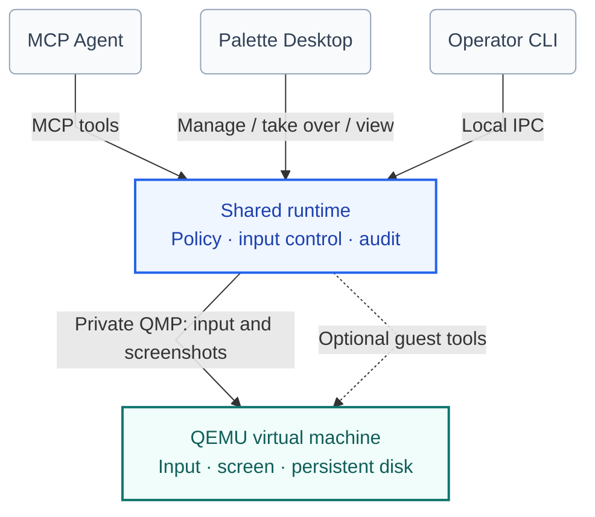

# Palette

**English** | [简体中文](README.zh-CN.md)

[](https://github.com/KashiwagiEri233/Palette/actions/workflows/ci.yml)

**Palette** gives visual AI agents an **observable, operable, resettable QEMU virtual desktop** alongside **Palette Desktop**, an Electron workbench for persistent VM management, live screen viewing, and exclusive human takeover.

Instead of operating the host desktop, agents connect over the Model Context Protocol (MCP), receive bounded desktop screenshots, and submit structured actions against an isolated QEMU guest. Authorization, coordinate and frame-epoch validation, single-writer scheduling, process supervision, and metadata-only auditing all happen behind the service boundary.

## Key Features

* **Deterministic Visual Loop & Frame Epoch Guards**: Built around `vm_observe → decide → vm_act(frame_id) → fresh screenshot`. Every coordinate action validates `instance_id`, `frame_id`, `boot_epoch`, `display_epoch`, `controller_epoch`, `action_seq`, and `frame_ttl_seconds` (30s by default). Stale frames or display resolution changes are immediately rejected with `STALE_FRAME`. In-process `request_id` deduplication and explicit receipt states (`not_sent`, `submitted`, `partial`, `unknown`) prevent blind retries.
* **Palette Desktop Workbench**: Built with Electron, React 19, TypeScript, Tailwind CSS v4, and noVNC. Create persistent VMs from read-only `qcow2`/`raw` base images or installer ISOs, configure hardware offline (1–64 vCPUs, 256–1,048,576 MiB RAM, safe offline disk expansion up to 4096 GiB, boot order, GPU & default resolution, network modes & localhost port forwarding, Intel HDA audio), or restore any VM to its initial state in one click.
* **Shared Runtime & Multi-Client Coexistence**: A single `RuntimeOwner` (`palette daemon` or managed `palette serve`) owns the VMs and serves Palette Desktop, the Operator CLI, and multiple MCP sessions (`palette serve --connect-only`) concurrently.
* **Exclusive Human-Agent Control Lease**: A single-writer input controller arbitrates desktop input. Operators can take over control from the Desktop console (backed by a 3-second heartbeat lease and automatic release on `Ctrl+Alt+G`, blur, or disconnect) or via `palette vm take-control`, immediately incrementing `controller_epoch` and retiring stale agent frames while still allowing agents to observe.
* **Read-Only Display Gateway & Strict Host Boundaries**: Palette never exposes raw QMP, HMP or a host shell to the agent. Optional Windows PowerShell runs inside the guest under its logged-in user's rights. QMP runs strictly over private child-process pipes (never TCP). Live desktop viewing uses a localhost WebSocket RFB gateway gated by one-time tickets and protocol-level write filtering. All managed overlays, scratch frames, and logs are confined to `.runtime/` via `PathGuard`.
* **Optional Agent Guest Enhancements**: Agents directly input Unicode/CJK text, read/write the guest clipboard, and transfer binary files through standard QEMU/SPICE and QGA services without operator clicks. See the [guest enhancement guide](docs/guest-enhancements.md). The separate custom service supports native text/app APIs: Alongside the visual baseline, `Guest Tool Bridge` exposes `vm_guest_input_text` (native Unicode/CJK text injection) and `vm_guest_launch_app` (launching allowlisted `app_id` entries) under the exact same policy, scheduling, and audit boundary — failing cleanly as `GUEST_TOOL_UNAVAILABLE` rather than silently downgrading to simulated keystrokes when no guest service is present.
* **Cross-Platform Hardware Acceleration & Explicit TCG**: Native profiles support Windows (`WHPX`), macOS Apple Silicon / Intel (`HVF`), and Linux x86_64 / aarch64 (`KVM`), plus explicit software emulation profiles (`tcg-x86_64`, `tcg-aarch64` — e.g., running an x86_64 guest on Apple Silicon without Rosetta). Missing hardware acceleration fails loudly and never falls back to TCG silently.

The Windows enhancement layer additionally provides file management, guest PowerShell, process/registry tools, App/window control, UIA snapshots and coordinate/label batches to both external MCP clients and the built-in Agent. The [enhancement guide](docs/guest-enhancements.md) describes installation and live capability checks.

## Architecture



Palette provides two complementary execution paths:

1. **Visual Baseline Path (always self-sufficient)**:
   `Agent → MCP Server → controlled QMP interface → QEMU standard HID / framebuffer`
2. **Retained Guest Enhancement Path (shares policy, scheduling, and audit; requires in-guest service)**:
   `Agent → same MCP Server → Guest Tool Bridge → in-guest tools (native text, launch app)`

## Quick Start

### 1. Prerequisites

* **Python**: `>= 3.12, < 3.14` and [uv](https://docs.astral.sh/uv/)
* **QEMU**: `qemu-system-x86_64` or `qemu-system-aarch64` plus `qemu-img` matching your target architecture, run as a **normal non-admin user**
* **Node.js**: `>= 22.19` (required for running or building Palette Desktop)
* **Guest Image**: A matching `qcow2`/`raw` base image or installer ISO (see the [guest template guide](docs/guest-template.md))

Install dependencies and probe your host environment from the repository root:

```bash
uv sync --locked
uv run palette doctor                 # probe host, QEMU, accelerator, firmware, and profile
```

### 2. Launch Palette Desktop

```bash
npm --prefix desktop ci
npm --prefix desktop run dev
```

Palette Desktop connects to an existing local runtime owner or spawns `palette daemon` automatically. From the GUI you can:

* Create persistent VMs from read-only base images (`qcow2` / `raw`) or installer ISOs;
* Configure vCPUs, memory, disk expansion, boot order, display resolution, networking/port forwards, and audio while the VM is stopped;
* View the live screen, click **Take Over** for an exclusive human input lease (`Ctrl+Alt+G` to release), or reset the VM to its initial state.

See the [desktop guide](docs/desktop.md) for full details.

### 3. Shared Daemon, CLI & MCP Workflow

Start the shared background daemon so Palette Desktop, the Operator CLI, and MCP clients can share one runtime owner:

```bash
# 1. Start and inspect the shared daemon
uv run palette daemon start
uv run palette daemon status

# 2. Operate VM lifecycle via CLI
uv run palette vm start --vm-id desktop
uv run palette vm status --vm-id desktop
uv run palette vm stop --vm-id desktop

# 3. Take over control or trigger an emergency stop
uv run palette vm take-control --vm-id desktop --reason "human debugging"
uv run palette vm emergency-stop --vm-id desktop

# 4. Stop the shared daemon
uv run palette daemon stop
```

### 4. Configure an MCP Client

Palette serves MCP over `stdio`. When `palette serve` detects a compatible running `daemon`, it automatically proxies to that owner. Pass `--connect-only` to require an existing owner, or `--standalone` to own a dedicated runtime for the duration of the stdio session.

Example MCP client configuration:

```json
{
  "mcpServers": {
    "palette": {
      "command": "uv",
      "args": ["run", "--directory", "/path/to/Palette", "palette", "serve"]
    }
  }
}
```

> **Note**: `vm_observe`, `vm_act`, and `vm_wait` return screenshots as `ImageContent` (`image/png`) while mirroring metadata in `structuredContent` and `TextContent`. Verify that your MCP client forwards image blocks to the vision model.

## Platform & Profile Matrix

`palette.toml` sets `default_profile = "auto"`, selecting the host's native hardware-accelerated profile automatically. See the [platform guide](docs/platforms.md) for prerequisites and firmware details.

| Profile ID | Host / Guest Target | Accelerator | Machine & Display | Description |
| --- | --- | --- | --- | --- |
| `default` | Windows x86_64 → x86_64 | `whpx` | `q35` + `VGA` | Default Windows profile (permissive switches for caller-supplied material) |
| `strict-example` | Windows x86_64 → x86_64 | `whpx` | `q35` + `VGA` | Locked-down posture (offline, all caller material & guest tools disabled) |
| `macos-aarch64` | macOS Apple Silicon → aarch64 | `hvf` | `virt` + `virtio-gpu-pci` (UEFI) | Native ARM64 desktop on Apple Silicon |
| `macos-x86_64` | macOS Intel → x86_64 | `hvf` | `q35` + `VGA` | Native x86_64 desktop on Intel Mac |
| `linux-x86_64` | Linux x86_64 → x86_64 | `kvm` | `q35` + `VGA` | Native x86_64 KVM desktop on Linux |
| `linux-aarch64` | Linux aarch64 → aarch64 | `kvm` | `virt` + `virtio-gpu-pci` (UEFI) | Native ARM64 KVM desktop on Linux |
| `tcg-x86_64` | Any supported host → x86_64 | `tcg` | `q35` + `VGA` (`cpu=max`) | Explicit software emulation (e.g., x86_64 guest on Apple Silicon without Rosetta) |
| `tcg-aarch64` | Any supported host → aarch64 | `tcg` | `virt` + `virtio-gpu-pci` (`cpu=max`) | Explicit software emulation for ARM64 guests |
| `tcg-debug` | Any supported host → x86_64 | `tcg` | `q35` + `VGA` | Legacy scratch-disk TCG debug profile (no guest-isolation guarantee) |

## MCP Tools & CLI Reference

### MCP Tool Surface

| Category | Tool Name | Summary |
| --- | --- | --- |
| **Discovery** | `vm_list` | Read-only list of persistent and runtime-known VMs, including stopped VMs, with IDs, names, state and control ownership; no host paths or configuration |
| **Visual Baseline** | `vm_status` | Report lifecycle state, QMP readiness, `screen_ready`, enabled capabilities, and currently held keys/buttons |
| **Visual Baseline** | `vm_observe` | Capture the guest screen as PNG and return a `frame` defining its coordinate space (supports `max_long_edge`) |
| **Visual Baseline** | `vm_act` | Perform one bounded action (`move`, `click`, `scroll`, `drag`, `key`, `type_text` in US printable ASCII) against a valid `frame_id` and return a receipt plus fresh screenshot |
| **Visual Baseline** | `vm_wait` | Wait up to 10s before observing again: `delay`, `changed` (pixel diff vs `after_frame_id`), or `stable` (two consecutive settled samples) |
| **Visual Baseline** | `vm_release_inputs` | Release all keys and pointer buttons held by the service and report `release_confirmed` honestly |
| **Lifecycle** | `vm_start` | Boot a VM instance from an allowed profile; optional `image`, `iso`, `extra_disks`, and `qemu_args` require individual profile switches |
| **Lifecycle** | `vm_stop` | Request guest shutdown and stop QEMU within the timeout budget (`allow_agent_stop`; `force=true` requires `allow_agent_force_stop`) |
| **Lifecycle** | `vm_reset` | Discard the writable overlay and rebuild a fresh instance from the read-only base image (`allow_agent_reset`) |
| **Guest Enhancement** | `vm_guest_input_text` | Direct Unicode/CJK input through standard clipboard_paste; native_text needs the custom service |
| **Guest Clipboard** | `vm_guest_clipboard_get` / `vm_guest_clipboard_set` | Direct guest text clipboard access, with no host clipboard or human lease |
| **Guest File Transfer** | `vm_guest_file_open` / `vm_guest_file_read` / `vm_guest_file_write` / `vm_guest_file_close` | QGA binary upload/download in bounded base64 chunks, no host file picker |
| **Guest Management** | `vm_guest_resize` / `vm_guest_sync_time` | Request guest resolution or synchronize time when supported |
| **Guest Enhancement** | `vm_guest_launch_app` | Launch an application by its registered `app_id` from the profile's allowlist; never accepts free-form commands or shells |

### Operator CLI Commands

| Command | Description |
| --- | --- |
| `palette doctor [--profile ID] [--json] [--hash-base]` | Probe host architecture, QEMU binary/devices, hardware accelerator, firmware, base image, and runtime directory |
| `palette daemon <start\|run\|status\|stop>` | Start, run in foreground, inspect, or stop the shared local runtime owner |
| `palette serve [--profile ID] [--standalone\|--connect-only]` | Run the MCP server over `stdio` (proxies to a running `daemon` by default) |
| `palette config show` | Print the resolved `palette.toml` and `profiles/*.toml` configuration as JSON |
| `palette vm <start\|stop\|reset\|status\|list>` | Start, stop, reset, inspect VM status, or list instance manifests on disk |
| `palette vm take-control [--vm-id ID] [--reason TEXT]` | Release held inputs, bump `controller_epoch`, and retire all active agent frames |
| `palette vm emergency-stop [--vm-id ID]` | Immediately release inputs, cancel queued actions, and kill the target (or every managed) QEMU process |

## Safety Defaults & Threat Boundaries

**Read the [threat model](docs/threat-model.md) before operating Palette.** Every row below is a profile switch. The shipped `profiles/default.toml` takes the permissive side for local experimentation; `profiles/strict-example.toml` closes all of them.

| Control | `default.toml` Default | What It Means |
| --- | --- | --- |
| **Network** | `restricted-lab` (virtual NIC) | Attaches a user-mode NIC with `restrict=on` so the guest cannot route past the sandbox. `nat` grants full host outbound reach with no egress policy; `offline` attaches no NIC; `internet-allowlist` is refused at start |
| **Host material: image** | `allow_agent_images = true` | Allows a caller to specify the base image path, bypassing the profile's pinned path and SHA-256 digest |
| **Host material: ISO / extra disk** | `allow_agent_iso = true` | Allows a caller to attach read-only CD-ROMs or extra disks from any host path |
| **Host material: QEMU arguments** | `allow_agent_qemu_args = true` | Allows a caller to append raw QEMU arguments, which **removes the host boundary entirely**: `-chardev`, `-device`, and `-blockdev` can read/write host files, and `-mon`/`-vnc` add a second control channel. Set to `false` in strict deployments |
| **QMP transport** | Private child-process pipes, never TCP | Unchanged by the switches above; QMP/HMP are never exposed over network sockets |
| **Palette's own paths** | Generated under `.runtime/`, never caller-supplied | Unchanged: cleanup only touches paths recorded in the instance `manifest.json` inside `runtime_root` and never deletes external base images |
| **Guest enhancement tools** | `enabled = true` | No-op until a guest-side service completes the handshake; calls against a guest without the service fail as `GUEST_TOOL_UNAVAILABLE` rather than becoming simulated keystrokes |
| **Agent lifecycle** | `start` only | `allow_agent_start = true`; `stop`, `force_stop`, and `reset` remain operator-only by default |
| **TCG fallback** | Disabled (hard rule) | Missing hardware acceleration is a diagnosed failure; the config loader rejects `allow_accelerator_fallback` |
| **Process lifetime & memory** | Host-specific enforcement | Windows uses a Kill-on-Close Job Object; macOS/Linux use a process-group supervisor and 250 ms RSS sampling |
| **Audit log** | Metadata only | Records action type, length, timing, outcome, and error code; **never** logs input text, launch arguments, persistent screenshots, or host paths |

## Repository Structure & Documentation

### Repository Layout

```
Palette/
├── palette.toml              # Host-level trusted configuration (default_profile, runtime_root, search paths)
├── profiles/                 # Hardware & security profile templates (*.toml)
├── src/palette/              # Python backend & MCP server implementation
│   ├── cli.py                # Operator CLI (doctor, serve, daemon, config, vm)
│   ├── server.py             # MCP tool surface, schemas, and image/structured responses
│   ├── service.py            # Core service: policy checks, action queue, frame guards, and audit
│   ├── runtime.py            # Shared RuntimeOwner (OperatorServer, DesktopManager, DisplayGateway)
│   ├── desktop.py            # Persistent VM definitions, disk resize, and initial-state reset
│   ├── vm_settings.py        # Typed VM hardware settings and local QEMU capability probes
│   ├── display.py            # Localhost ticketed read-only WebSocket RFB display gateway
│   ├── control.py            # Human-agent control lease and heartbeat manager
│   ├── policy.py             # PathGuard confinement, lifecycle permissions, and capability switches
│   ├── qmp/                  # Private-pipe QMP transport and protocol client
│   ├── vm/                   # QEMU launcher, qcow2 overlay manager, lifecycle state machine, process guard
│   ├── capture/              # Framebuffer capture and PNG/PPM fallback
│   ├── input/                # Coordinate transforms, US keymap table, and bounded input controller
│   └── guest_tools/          # In-guest enhancement channel protocol and bridge
├── desktop/                  # Palette Desktop app (Electron + React 19 + TypeScript + Vite)
├── docs/                     # Bilingual (English & Simplified Chinese) documentation suite
├── guest/                    # Offline acceptance fixture and in-guest service protocol docs
├── scripts/                  # Operator probes (p0_probe.py, mcp_stdio_smoke.py) and doc checker (check_docs.py)
└── tests/                    # Unit, QMP, guest-tools, IPC, integration, and real-QEMU E2E test suites
```

### Documentation Index

Every documentation page in `docs/` is maintained in both English and Simplified Chinese and verified by `scripts/check_docs.py`:

| Document | Description |
| --- | --- |
| [Documentation Index](docs/README.md) · [简体中文](docs/README.zh-CN.md) | Overview of all guides, code map, and test suite structure |
| [Desktop Guide](docs/desktop.md) · [简体中文](docs/desktop.zh-CN.md) | Source setup, persistent VM creation, hardware settings, human takeover, and shared daemon usage |
| [User Guide](docs/user-guide.md) · [简体中文](docs/user-guide.zh-CN.md) | For agent and MCP client authors: tool schemas, work loop, text rules, and error handling |
| [Operator Runbook](docs/operator.md) · [简体中文](docs/operator.zh-CN.md) | For host operators: installation, profiles, lifecycle, emergency stop, and recovery |
| [Platforms \& Architectures](docs/platforms.md) · [简体中文](docs/platforms.zh-CN.md) | Native WHPX/HVF/KVM profiles, explicit cross-ISA TCG, UEFI firmware, and resource caps |
| [Guest Template Guide](docs/guest-template.md) · [简体中文](docs/guest-template.zh-CN.md) | Building and pinning the Debian 13 + XFCE base image |
| [Threat Model](docs/threat-model.md) · [简体中文](docs/threat-model.zh-CN.md) | Trust boundaries, caller-opened switches, enforced invariants, and non-goals |
| [Acceptance Test Guide](docs/acceptance-test.md) · [简体中文](docs/acceptance-test.zh-CN.md) | End-to-end verification from MCP connection and agent clicks to GUI display sync |
| [Benchmarks](docs/benchmarks.md) · [简体中文](docs/benchmarks.zh-CN.md) | Latency targets and measurement harness (`scripts/p0_probe.py`) |
| [Known Limitations](docs/known-limitations.md) · [简体中文](docs/known-limitations.zh-CN.md) | Current boundaries around IME, clipboard, allowlist networking, and multi-monitor |
| [In-Guest Agent Contract](guest/agent/README.md) · [简体中文](guest/agent/README.zh-CN.md) | JSON-Lines protocol specification for the optional `virtio-serial` guest service |

## Development & Verification

Run the Python test suite, linter, formatter check, strict type checker, and documentation validator:

```bash
uv run pytest
uv run ruff check .
uv run ruff format --check .
uv run mypy
uv run python scripts/check_docs.py
```

Run the Palette Desktop unit tests (Vitest) and Electron end-to-end tests (Playwright):

```bash
npm --prefix desktop test
npm --prefix desktop run test:e2e
```

On a host configured with a real QEMU binary and guest image, run the MCP stdio smoke test and P0 hardware probe:

```bash
uv run python scripts/mcp_stdio_smoke.py   # verify MCP session and framing resilience over stdio
uv run python scripts/p0_probe.py          # measure cold boot, capture latency, and click-to-frame timing
```

> **Verification Note**: Default automated tests validate protocol framing, policy enforcement, lifecycle cleanup, and UI flows against supervised fake QMP child processes and local RFB connections. Physical hardware acceptance requires `PALETTE_E2E=1` with a real QEMU installation and matching guest image (see the [operator runbook](docs/operator.md) and [acceptance test guide](docs/acceptance-test.md)).

## License

Licensed under the [Apache-2.0 License](LICENSE).

## Optional Guest Enhancements

See the [guest enhancement guide](docs/guest-enhancements.md) for guest installation, automatic capability detection and degradation, Unicode clipboard, automatic resolution, QGA management, file transfer, and private WebDAV shared directories. Missing tools preserve the basic VM console.
