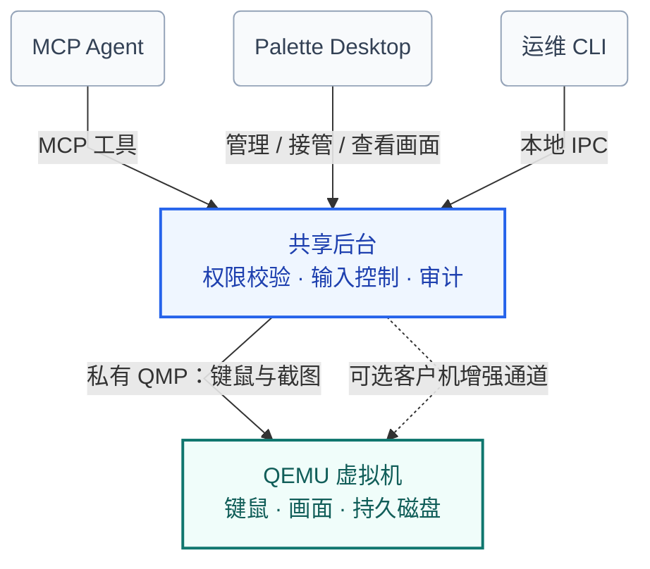

# Palette

[English](README.md) | **简体中文**

[](https://github.com/KashiwagiEri233/Palette/actions/workflows/ci.yml)

**Palette** 为视觉 AI Agent 提供一个**可观察、可操作、可重置的 QEMU 虚拟桌面**，并配套提供 **Palette Desktop（Electron 桌面工作台）**，支持持久虚拟机管理、实时画面查看与独占式人工键鼠接管。

Agent 通过标准 Model Context Protocol（MCP）接收桌面截图并发送有界动作，操作独立的 QEMU 客户机而非宿主机桌面；授权校验、坐标与帧代次（Epoch）检查、单写入者调度、进程生命周期监管与无敏感正文审计全部在服务端边界内强制执行。

## 核心特性

* **视觉基线闭环与帧代次防抖**：围绕 `vm_observe → 决策 → vm_act(frame_id) → 动作后新截图` 构建确定性交互循环。每次坐标动作均严格校验 `instance_id`、`frame_id`、`boot_epoch`、`display_epoch`、`controller_epoch`、`action_seq` 与帧有效期（默认 30 秒）；画面过期或分辨率变化立即以 `STALE_FRAME` 拒绝，绝不在失效坐标上盲点。支持基于 `request_id` 的进程内幂等去重与明确的效果回执（`not_sent` / `submitted` / `partial` / `unknown`）。
* **Palette Desktop 桌面工作台**：基于 Electron、React 19、TypeScript、Tailwind CSS v4 与 noVNC 构建。支持从 `qcow2`/`raw` 基础镜像或安装 ISO 创建持久虚拟机，提供完整的离线硬件配置面板（1–64 核 vCPU、256–1,048,576 MiB 内存、最高 4096 GiB 写层安全扩容、启动顺序、显卡与默认分辨率、网络模式与本机端口转发、Intel HDA 音频输出），以及一键**恢复初始状态**。
* **共享后台与多端协同**：通过单一 `RuntimeOwner`（`palette daemon` 或托管 `palette serve`）统一管理虚拟机状态。Palette Desktop、运维 CLI 与多个 MCP 客户端（`palette serve --connect-only`）可安全共用同一个后台进程。
* **人机独占控制权交接**：采用单写入者输入控制器。运维人员可在桌面端控制台点击“接管”（带 3 秒心跳租约，支持 `Ctrl+Alt+G`、失焦或断线自动释放键鼠）或执行 `palette vm take-control`，立即递增 `controller_epoch` 并作废 Agent 手中的旧 frame；人工操控期间 Agent 仍可调用 `vm_observe` 观察画面，但写入请求会被安全拦截。
* **只读画面网关与严密宿主边界**：从不向 Agent 暴露原始 QMP、HMP 或通用客户机 Shell。QMP 始终运行在受监管子进程的私有管道上（绝不监听 TCP）；桌面端实时画面通过仅监听本机的 WebSocket RFB 网关传输，采用一次性票据并在协议层过滤写入消息。所有受管可写层、临时帧与日志经 `PathGuard` 严格收敛在 `.runtime/` 目录内。
* **可选 Agent 增强能力**：Agent 通过标准 QEMU/SPICE 与 QGA 服务直接输入中文、读写客户机剪贴板并传输二进制文件，无需人工点击，参阅[增强工具指南](docs/guest-enhancements.zh-CN.md)。独立的自定义服务继续支持原生文本与应用接口：在保持视觉基线独立可用的前提下，提供受同一套策略、调度与审计约束的 `Guest Tool Bridge`（`vm_guest_input_text` 原生 Unicode/中文文本输入、`vm_guest_launch_app` 受控白名单应用启动）。客户机未运行增强服务时如实返回 `GUEST_TOOL_UNAVAILABLE`，绝不静默降级为模拟按键。
* **跨平台硬件加速与显式 TCG**：原生支持 Windows（`WHPX`）、macOS Apple Silicon / Intel（`HVF`）与 Linux x86_64 / aarch64（`KVM`），并提供显式软件模拟配置（`tcg-x86_64`、`tcg-aarch64`，例如在 Apple Silicon 上免 Rosetta 运行 x86_64 客户机）。缺少硬件加速时直接诊断报错，绝不静默回退到 TCG。

## 系统架构



Palette 提供两条互补的交互路径：

1. **视觉基线路线（默认独立可用）**：
   `Agent → MCP 服务器 → 受控 QMP 接口 → QEMU 标准 HID 设备 / 显示缓冲区`
2. **保留的客户机增强路线（共用同一套权限、调度与审计，需客户机内运行配套服务）**：
   `Agent → 同一 MCP 服务器 → Guest Tool Bridge → 客户机内增强工具（原生文本、启动注册程序）`

## 快速开始

### 1. 环境准备

* **Python**：`>= 3.12, < 3.14` 与 [uv](https://docs.astral.sh/uv/)
* **QEMU**：安装匹配目标架构的 `qemu-system-x86_64` 或 `qemu-system-aarch64` 以及 `qemu-img`，并以**普通非管理员用户**运行
* **Node.js**：`>= 22.19`（仅运行或构建 Palette Desktop 时需要）
* **客户机镜像**：准备匹配的 `qcow2`/`raw` 桌面基础镜像或系统安装 ISO（构建说明见[客户机模板指南](docs/guest-template.zh-CN.md)）

在仓库根目录同步依赖并执行环境自检：

```bash
uv sync --locked
uv run palette doctor                 # 探测宿主环境、QEMU、硬件加速器、固件与默认 profile
```

### 2. 启动 Palette Desktop（桌面工作台）

```bash
npm --prefix desktop ci
npm --prefix desktop run dev
```

桌面应用启动后会自动连接已有的本机后台，或在后台不存在时自动拉起 `daemon`。你可以在图形界面中：

* 通过向导导入只读基础镜像（`qcow2` / `raw`）或挂载安装 ISO 创建持久虚拟机；
* 在关机状态下调整处理器、内存、磁盘容量、启动顺序、显卡分辨率、网络与端口转发、音频输出；
* 实时查看客户机画面，随时点击**接管**获取独占键鼠控制权（按 `Ctrl+Alt+G` 释放），或一键**恢复初始状态**。

完整桌面端说明见[桌面应用指南](docs/desktop.zh-CN.md)。

### 3. 共享后台、CLI 与 MCP 协同工作流

推荐启动共享 `daemon`，让桌面端、CLI 与 MCP 客户端共用同一个后台：

```bash
# 1. 启动并检查共享后台
uv run palette daemon start
uv run palette daemon status

# 2. 通过 CLI 管理虚拟机生命周期
uv run palette vm start --vm-id desktop
uv run palette vm status --vm-id desktop
uv run palette vm stop --vm-id desktop

# 3. 紧急停止或人工接管控制权
uv run palette vm take-control --vm-id desktop --reason "human debugging"
uv run palette vm emergency-stop --vm-id desktop

# 4. 停止共享后台
uv run palette daemon stop
```

### 4. 配置 MCP 客户端

Palette 通过 `stdio` 提供 MCP 服务。`palette serve` 发现已有兼容 `daemon` 时会自动作为代理连接；若需强制仅连接已有后台，可追加 `--connect-only`；若需由当前 MCP 会话独占后台生命周期，可追加 `--standalone`。

典型 MCP 客户端配置示例：

```json
{
  "mcpServers": {
    "palette": {
      "command": "uv",
      "args": ["run", "--directory", "/path/to/Palette", "palette", "serve"]
    }
  }
}
```

> **提示**：`vm_observe`、`vm_act` 与 `vm_wait` 会将截图以 `ImageContent`（PNG）返回，同时将结构化元数据写入 `structuredContent` 与 `TextContent`。请确认你的 MCP 客户端确实把图像块转发给了视觉模型。

## 平台与 Profile 矩阵

`palette.toml` 中默认设置 `default_profile = "auto"`，会根据宿主操作系统与架构自动选择对应的原生硬件加速 Profile。完整说明见[平台与客户机架构指南](docs/platforms.zh-CN.md)。

| Profile ID | 适用宿主 / 目标架构 | 加速器 | 机器与显示模型 | 典型用途 |
| --- | --- | --- | --- | --- |
| `default` | Windows x86_64 → x86_64 | `whpx` | `q35` + `VGA` | Windows 默认配置（宽松开关，允许调用方传入镜像/ISO/参数） |
| `strict-example` | Windows x86_64 → x86_64 | `whpx` | `q35` + `VGA` | 严格隔离示例（离线无网卡、关闭所有调用方材料与增强通道） |
| `macos-aarch64` | macOS Apple Silicon → aarch64 | `hvf` | `virt` + `virtio-gpu-pci` (UEFI) | Apple Silicon 原生 ARM64 虚拟桌面 |
| `macos-x86_64` | macOS Intel → x86_64 | `hvf` | `q35` + `VGA` | Intel Mac 原生 x86_64 虚拟桌面 |
| `linux-x86_64` | Linux x86_64 → x86_64 | `kvm` | `q35` + `VGA` | Linux x86_64 原生 KVM 虚拟桌面 |
| `linux-aarch64` | Linux aarch64 → aarch64 | `kvm` | `virt` + `virtio-gpu-pci` (UEFI) | Linux ARM64 原生 KVM 虚拟桌面 |
| `tcg-x86_64` | 任意受支持宿主 → x86_64 | `tcg` | `q35` + `VGA` (`cpu=max`) | 显式跨架构软件模拟（如 Apple Silicon 免 Rosetta 运行 x86_64） |
| `tcg-aarch64` | 任意受支持宿主 → aarch64 | `tcg` | `virt` + `virtio-gpu-pci` (`cpu=max`) | 显式跨架构软件模拟（如在 x86_64 宿主上模拟 ARM64） |
| `tcg-debug` | 任意受支持宿主 → x86_64 | `tcg` | `q35` + `VGA` | 旧版空白盘软件模拟调试 Profile（无客户机硬件隔离保证） |

## MCP 工具与 CLI 命令速览

### MCP 工具表面

| 类别 | 工具名 | 权限与行为说明 |
| --- | --- | --- |
| **发现** | `vm_list` | 只读列出持久化及运行时已知 VM（包括停机条目）的 ID、名称、状态与控制权；不返回宿主路径或配置 |
| **视觉基线** | `vm_status` | 查询生命周期状态、QMP 通道在线状态、`screen_ready`、已启用能力及当前按住的键鼠状态 |
| **视觉基线** | `vm_observe` | 抓取当前屏幕 PNG 截图并返回定义坐标空间的 `frame`（支持 `max_long_edge` 缩放） |
| **视觉基线** | `vm_act` | 基于最新 `frame_id` 执行单次有界动作：`move`、`click`、`scroll`、`drag`、`key`、`type_text`（US 可打印 ASCII），返回回执与动作后新截图 |
| **视觉基线** | `vm_wait` | 等待画面变化或稳定后再次截图：`delay`（固定等待）、`changed`（像素变化）、`stable`（连续采样稳定），上限 10 秒 |
| **视觉基线** | `vm_release_inputs` | 释放当前服务在该实例上按住的所有按键与鼠标按钮，并如实报告 `release_confirmed` |
| **生命周期** | `vm_start` | 按允许的 profile 启动实例；可选传入 `image`、`iso`、`extra_disks`、`qemu_args`（每项均需 profile 对应开关放行） |
| **生命周期** | `vm_stop` | 请求客户机正常关机并在超时预算内结束 QEMU（需 `allow_agent_stop`；`force=true` 需 `allow_agent_force_stop`） |
| **生命周期** | `vm_reset` | 丢弃当前可写 overlay 并从只读基础镜像重建干净实例（破坏性操作，需 `allow_agent_reset`） |
| **客户机增强** | `vm_guest_input_text` | 标准 clipboard_paste 直接输入中文与 Unicode；native_text 需要自定义服务 |
| **客户机剪贴板** | `vm_guest_clipboard_get` / `vm_guest_clipboard_set` | 直接读写客户机文本剪贴板，无需宿主剪贴板或人工租约 |
| **客户机文件传输** | `vm_guest_file_open` / `vm_guest_file_read` / `vm_guest_file_write` / `vm_guest_file_close` | QGA 二进制上传/下载，有界 Base64 分块，无需宿主文件选择器 |
| **客户机管理** | `vm_guest_resize` / `vm_guest_sync_time` | 按客户机能力请求分辨率或同步时间 |
| **客户机增强** | `vm_guest_launch_app` | 启动 profile 白名单中注册的 `app_id` 与受限选项，绝不接受自由命令行或 Shell |

### 运维 CLI 命令

| 命令 | 作用 |
| --- | --- |
| `palette doctor [--profile ID] [--json] [--hash-base]` | 检查宿主架构、QEMU 版本与设备支持、硬件加速器、固件、基础镜像与运行目录权限 |
| `palette daemon <start\|run\|status\|stop>` | 启动、前台运行、查询或停止供桌面端与 MCP 共用的本机后台 owner |
| `palette serve [--profile ID] [--standalone\|--connect-only]` | 在 `stdio` 上运行 MCP 服务器（默认优先代理连接已有 `daemon`） |
| `palette config show` | 输出解析后的 `palette.toml` 与所有 `profiles/*.toml` 可信配置 |
| `palette vm <start\|stop\|reset\|status\|list>` | 以运维身份启动、停止、重置、查询虚拟机状态或离线列出磁盘上的实例 manifest |
| `palette vm take-control [--vm-id ID] [--reason TEXT]` | 释放输入、递增 `controller_epoch` 并立即作废 Agent 手中的所有旧 frame |
| `palette vm emergency-stop [--vm-id ID]` | 紧急释放所有按住的输入、取消排队动作并立即终止目标（或全部）受管 QEMU 进程 |

## 安全默认值与边界控制

**运行前请先阅读[威胁模型](docs/threat-model.zh-CN.md)**。下表中的每一行都是 Profile 中的显式开关：随仓库提供的 `profiles/default.toml` 在调用方材料等开关上取宽松一侧以方便实验，而 `profiles/strict-example.toml` 将这些开关全部关闭。

| 控制项 | `default.toml` 默认值 | 边界含义与安全影响 |
| --- | --- | --- |
| **网络模式** | `restricted-lab`（有虚拟网卡） | 使用开启 `restrict=on` 的 QEMU user-mode 网络，客户机无法路由出沙箱；`nat` 拥有与宿主同等的出站能力且无出站策略；`offline` 不附带任何网卡；`internet-allowlist` 因缺乏强制网关而在启动时被拒绝 |
| **宿主机材料：镜像** | `allow_agent_images = true` | 允许调用方指定基础镜像路径，绕过 profile 固定的路径与 SHA-256 摘要 |
| **宿主机材料：ISO / 额外磁盘** | `allow_agent_iso = true` | 允许调用方从任意宿主路径只读挂载 CD-ROM 或额外磁盘 |
| **宿主机材料：QEMU 参数** | `allow_agent_qemu_args = true` | 允许调用方追加原始 QEMU 参数，**这会彻底取消宿主边界**：`-chardev`、`-device`、`-blockdev` 可读写宿主任意文件，`-mon`/`-vnc` 会引入第二条控制通道。生产或不可信环境请务必设为 `false` |
| **QMP 管理传输** | 私有子进程管道，绝不用 TCP | 不受上述开关影响，永远不在网络端口上暴露 QMP 或 HMP |
| **Palette 受管路径** | `.runtime/` 下自动生成 | 不受上述开关影响：清理与删除操作仅触及登记在实例 `manifest.json` 中且位于 `runtime_root` 内的文件，永不删除外部基础镜像 |
| **客户机增强工具** | `enabled = true` | 在客户机内服务完成握手前不产生任何效果；无服务应答时如实报错 `GUEST_TOOL_UNAVAILABLE`，绝不静默转为键盘模拟 |
| **Agent 生命周期权限** | 仅允许 `start` | `allow_agent_start = true`；停止（`stop`）、强制停止（`force_stop`）与重置（`reset`）默认关闭，归属运维 |
| **TCG 回退保护** | 永久关闭（硬性约束） | 缺少硬件加速直接诊断失败，加载器拒绝任何 `allow_accelerator_fallback` 配置 |
| **进程寿命与内存上限** | 依宿主平台强制执行 | Windows 使用 Kill-on-Close Job Object；macOS/Linux 使用独立 supervisor 进程组与 250 ms RSS 采样限制 |
| **审计日志** | 仅记录元数据 | 只记录动作类型、输入长度、耗时、结果与错误码；**绝不**记录输入文本正文、启动参数、持久截图或宿主机路径 |

## 仓库结构与文档导航

### 目录结构

```
Palette/
├── palette.toml              # 宿主机级可信配置（默认 profile、runtime_root、QEMU 搜索路径）
├── profiles/                 # 按平台与安全姿态划分的虚拟机 Profile 模板 (*.toml)
├── src/palette/              # Python 核心后端与 MCP 服务器实现
│   ├── cli.py                # 运维 CLI (doctor, serve, daemon, config, vm)
│   ├── server.py             # MCP 工具契约、图像与结构化结果封装
│   ├── service.py            # 核心服务：策略校验、动作队列、帧验证与审计调度
│   ├── runtime.py            # 共享 RuntimeOwner（统一承载 OperatorServer、DesktopManager、DisplayGateway）
│   ├── desktop.py            # 持久虚拟机定义管理、磁盘扩容与初始状态恢复
│   ├── vm_settings.py        # 虚拟机硬件设置模型与本机 QEMU 能力探测
│   ├── display.py            # 仅限本机的单次票据只读 WebSocket RFB 画面网关
│   ├── control.py            # 人机控制权租约与心跳管理
│   ├── policy.py             # PathGuard 路径收敛、生命周期授权与能力开关
│   ├── qmp/                  # 私有管道 QMP 协议客户端与传输层
│   ├── vm/                   # QEMU 启动器、qcow2 overlay 管理、生命周期状态机与进程保护
│   ├── capture/              # 帧缓冲截图采集与 PNG/PPM 回退
│   ├── input/                # 坐标空间换算、US 键码表与有界动作控制器
│   └── guest_tools/          # 客户机内增强通道协议与 Bridge
├── desktop/                  # Palette Desktop (Electron + React 19 + TypeScript + Vite)
├── docs/                     # 中英双语完整文档集
├── guest/                    # 离线验收夹具页面与客户机内增强服务契约文档
├── scripts/                  # 运维探针 (p0_probe.py, mcp_stdio_smoke.py) 与文档检查 (check_docs.py)
└── tests/                    # 单元、QMP、客户机工具、IPC、集成与实机 E2E 测试套件
```

### 文档导航

`docs/` 下的所有文档均提供**中英双语**版本，并由 `scripts/check_docs.py` 自动校验配对与相对链接完整性：

| 文档 | 内容说明 |
| --- | --- |
| [文档总览](docs/README.zh-CN.md) · [English](docs/README.md) | 全部文档索引、核心代码模块映射与测试分层说明 |
| [桌面应用指南](docs/desktop.zh-CN.md) · [English](docs/desktop.md) | Palette Desktop 源码运行、持久 VM 创建、硬件设置、人工接管与后台共享 |
| [用户指南](docs/user-guide.zh-CN.md) · [English](docs/user-guide.md) | 面向 Agent 与 MCP 客户端作者：工具参数、工作循环、文本限制与错误码处理 |
| [运维指南](docs/operator.zh-CN.md) · [English](docs/operator.md) | 面向宿主机管理员：安装检查、Profile 配置、生命周期、紧急停止与故障恢复 |
| [平台与客户机架构](docs/platforms.zh-CN.md) · [English](docs/platforms.md) | Windows/macOS/Linux 原生加速矩阵、显式跨架构 TCG、UEFI 固件与进程资源限制 |
| [客户机模板构建](docs/guest-template.zh-CN.md) · [English](docs/guest-template.md) | Debian 13 + XFCE 标准客户机基础镜像构建清单与哈希固定方法 |
| [威胁模型](docs/threat-model.zh-CN.md) · [English](docs/threat-model.md) | 信任边界、可打开开关的后果、服务端强制保证与明确不在防护范围内的事项 |
| [完整验收测试流程](docs/acceptance-test.zh-CN.md) · [English](docs/acceptance-test.md) | 从 MCP 连接、Agent 视觉点击到 GUI 画面及状态同步的端到端验收步骤 |
| [性能基准测试](docs/benchmarks.zh-CN.md) · [English](docs/benchmarks.md) | P0 探针延迟指标定义（冷启动、截图延迟、点击到新帧耗时）与测量方法 |
| [已知限制](docs/known-limitations.zh-CN.md) · [English](docs/known-limitations.md) | 当前版本在输入法、剪贴板、网络白名单、多显示器等方面的诚实边界清单 |
| [客户机增强服务契约](guest/agent/README.zh-CN.md) · [English](guest/agent/README.md) | 客户机内 `virtio-serial` 增强服务的 JSON-Lines 握手与调用协议规范 |

## 开发与验证

运行后端测试、代码风格检查、严格类型检查与双语文档校验：

```bash
uv run pytest
uv run ruff check .
uv run ruff format --check .
uv run mypy
uv run python scripts/check_docs.py
```

运行桌面端单元测试（Vitest）与 Electron 端到端测试（Playwright）：

```bash
npm --prefix desktop test
npm --prefix desktop run test:e2e
```

在配置好真实 QEMU 与客户机镜像的宿主机上，可运行运维探针与 MCP 传输冒烟测试：

```bash
uv run python scripts/mcp_stdio_smoke.py   # 验证真实 stdio 上的 MCP 会话与容错能力
uv run python scripts/p0_probe.py          # 实机冷启动、截图、点击并输出各项延迟指标
```

> **关于验证边界的说明**：默认自动化测试套件通过受监督的 fake QMP 子进程与本地真实管道/RFB 连接验证协议分帧、权限策略、生命周期回收与界面交互；实机硬件加速与桌面兼容性验收需设置 `PALETTE_E2E=1` 并提供真实 QEMU 与客户机镜像（详见[运维指南](docs/operator.zh-CN.md)与[完整验收测试流程](docs/acceptance-test.zh-CN.md)）。

## 许可证

本项目基于 [Apache-2.0 许可证](LICENSE)开源。

## 可选虚拟机增强工具

客户机安装、能力自动检测与降级、中文剪贴板、自动分辨率、QGA 管理、文件传输和私有 WebDAV 共享目录，请参阅[增强工具指南](docs/guest-enhancements.zh-CN.md)。缺少工具时仍可使用基础虚拟机控制台。
